

  

  <b>Creado por HRLD CORP CODE · Harold Charro López</b>
  &nbsp;·&nbsp; <b>Propiedad intelectual privada</b>

  
  
  
  
  

> **Este repositorio es una vitrina.** Aquí se presenta el proyecto, su razón de ser y su aspecto. **El código fuente es privado** y no se publica.

---

## COPILOTO en una frase

**COPILOTO es el asistente de quien conduce el transporte escolar solo.** Le lleva la lista, le recuerda la hora, le cuida las cuentas y le avisa a las familias, para que sus manos y sus ojos se queden en el camino.

No es la aplicación de siempre para que los padres vean un puntito moviéndose en un mapa. **El cliente es el conductor.**

---

## El dolor que le dio origen

Un conductor de transporte escolar en Ecuador suele trabajar **solo**, con varios recorridos al día (por ejemplo, dos de ida y dos de regreso) y unas treinta familias a su cargo. No tiene secretaria, ni ayudante, ni quien conteste el teléfono. Un día cualquiera se parece a esto:

| Lo que le pasa | Lo que cuesta |
|---|---|
| El celular suena mientras maneja: *«mi hija hoy no va»*, *«¿ya viene?»*, *«cambió la dirección»*. | Distracción al volante y mensajes que se pierden. |
| Las listas de alumnos cambian cada semana y viven en papeles, cuadernos y chats. | Errores: esperar a quien no va, olvidar a quien sí. |
| Cada familia paga **un valor distinto** según la distancia; hay abonos, promesas de pago y un aporte mensual a la cooperativa. | Cuentas hechas a mano, recibos a mano, discusiones por saldos. |
| La ruta se maneja de memoria y las casas se ubican «por referencia». | Retrasos, paradas mal puestas, dependencia de una sola persona. |
| Quien sustituye al conductor un día no conoce nada de lo anterior. | El servicio depende de la memoria de una persona. |
| El conductor es una **persona mayor** y no creció con aplicaciones. | Pantallas llenas de campos y letra pequeña lo abruman y las abandona. |

Ninguna aplicación de seguimiento resuelve esto. Sirven a quien **mira** el recorrido, no a quien lo **hace**.

---

## La idea: un asistente, no un rastreador

| Aplicación de seguimiento convencional | **COPILOTO** |
|---|---|
| Pensada para los padres | **Pensada para el conductor** |
| Muestra dónde está el bus | Le **dice al conductor qué hacer ahora** y lo hace por él |
| Exige que el conductor mire y toque la pantalla | **Manos libres:** voz, un botón grande, nada obligatorio |
| Solo ubicación | Lista, asistencia, novedades, cobros, recibos, informes y avisos |
| Igual para todos | Diseñada con y para una **persona de la tercera edad** |

---

## Qué hace, explicado por problema

### 🎙 «No puedo mirar el teléfono mientras manejo»
- **Indicaciones de giro por voz**, en español, y aviso de cada parada: *«Parada Las Cuadras. Suben Ana y Luis»*.
- Un **reloj de números grandes** con la hora a la que se debe llegar a la próxima parada; al tocarlo, **lo dice en voz alta**.
- Un solo botón enorme (**LLEGÓ**) y otro para *«el niño no salió»*. Todo lo demás queda un toque más atrás.
- Mapa que **gira según hacia dónde se va**, como un navegador, en celular o tablet, en vertical o en horizontal.

### 🗒 «Las listas y las novedades me desordenan el día»
- **Pase de lista** antes de salir: subió, no salió, lo retiraron.
- Si una familia avisa que no va, **esa parada se salta sola**: nadie pierde tiempo esperando.
- Las novedades quedan registradas, con la hora y quién avisó.
- Alumnos y pasajeros externos (no solo estudiantes) en un mismo lugar, con filtros claros.

### 💰 «Las cuentas me quitan el sueño»
- **Pensión distinta por alumno**, abonos, saldos y **promesas de pago** («pago el 10»).
- **Recibos en PDF** que se envían por WhatsApp con un toque.
- Aporte a la cooperativa calculado, recordatorios de cobro y **informes** para saber quién debe qué.

### 👨‍👩‍👧 «Las familias quieren saber, y yo no puedo escribir»
- La aplicación **prepara cada mensaje**, con trato de *usted*, y el conductor solo confirma.
- Pedido de **ubicación exacta de la casa**: la familia manda su pin y la parada queda ubicada.
- Camino hacia el envío **automático** con la API oficial de WhatsApp Business.

### 👀 «Quiero saber cómo va el recorrido, aunque no vaya en el bus»
- **Seguimiento en vivo** en el celular de quien lo necesite, en modo **«solo mirar»**: ve el avance, quién subió y cuánto falta, sin poder tocar nada.

### 📊 «Quiero acordarme de cómo fue cada día»
- Cada recorrido deja su **memoria**: kilómetros, tiempos, esperas por parada, asistencia.
- **Informe diario en PDF**, guardado en un banco dentro de la aplicación, listo para compartir.
- **Copias de respaldo** de los datos hacia Google Drive.

---

## Capturas

> Las imágenes usan **datos totalmente ficticios** (nombres, teléfonos y pagos inventados). No se muestran familias reales.

<table>
  <tr>
    <td align="center" width="33%">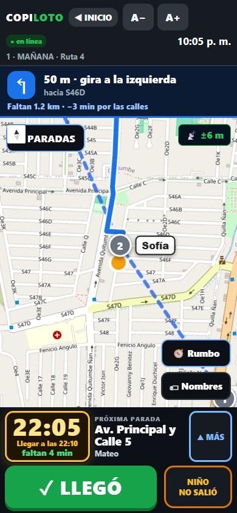 <b>Recorrido pensado para manejar.</b> Mapa que gira, indicación de giro, reloj grande y un botón principal.</td>
    <td align="center" width="33%">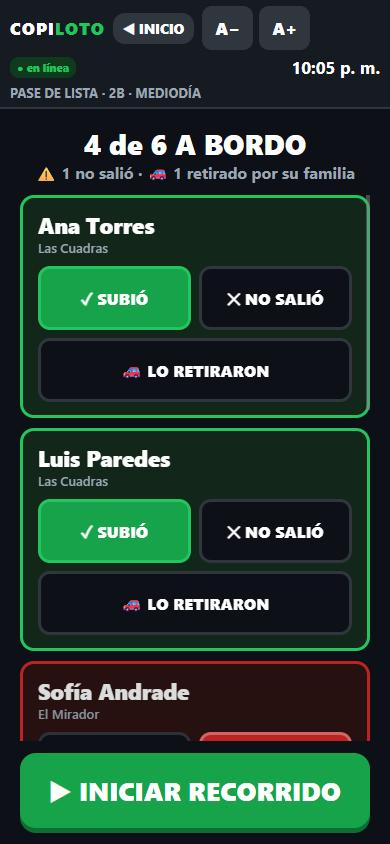 <b>Pase de lista.</b> Tres opciones claras por persona.</td>
    <td align="center" width="33%">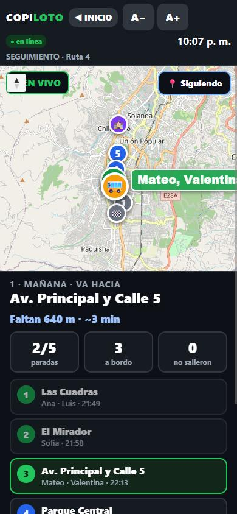 <b>Seguimiento en vivo.</b> Para quien mira, sin poder tocar el recorrido.</td>
  </tr>
  <tr>
    <td align="center">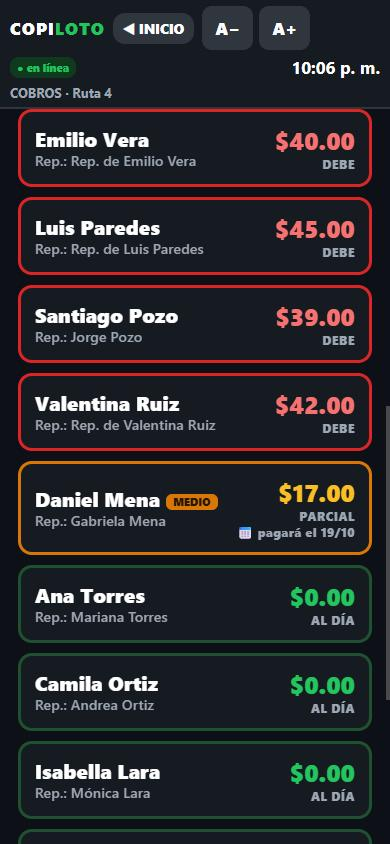 <b>Cobros.</b> Quién debe, quién pagó parte y quién prometió pagar.</td>
    <td align="center">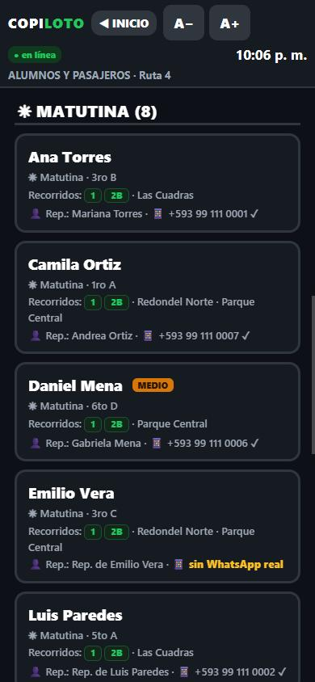 <b>Alumnos y pasajeros.</b> Recorridos, parada y contacto de cada familia.</td>
    <td align="center">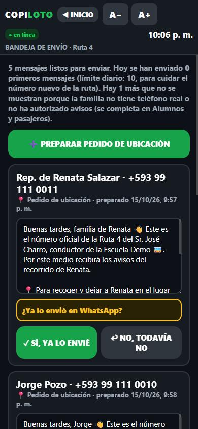 <b>Bandeja de envío.</b> El mensaje ya está escrito; el conductor confirma.</td>
  </tr>
</table>

### En tablet

<table>
  <tr>
    <td align="center" width="50%">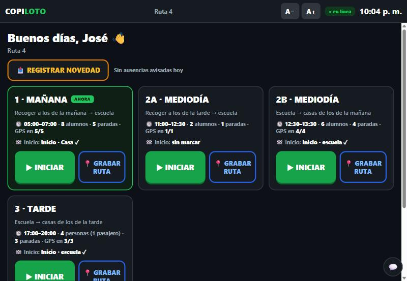 <b>Inicio.</b> Los cuatro recorridos del día, con hora y paradas.</td>
    <td align="center" width="50%">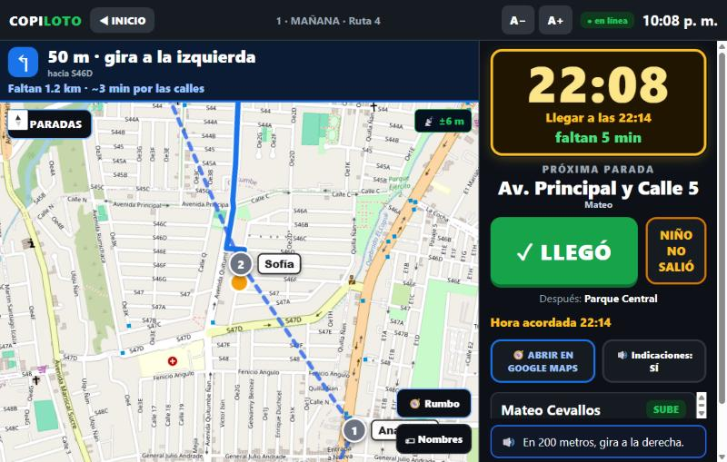 <b>Recorrido en horizontal.</b> Reloj y botones siempre a la vista.</td>
  </tr>
  <tr>
    <td align="center">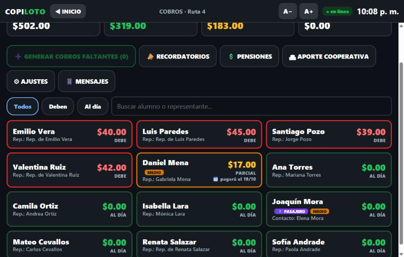 <b>Cobros en tablet.</b></td>
    <td align="center">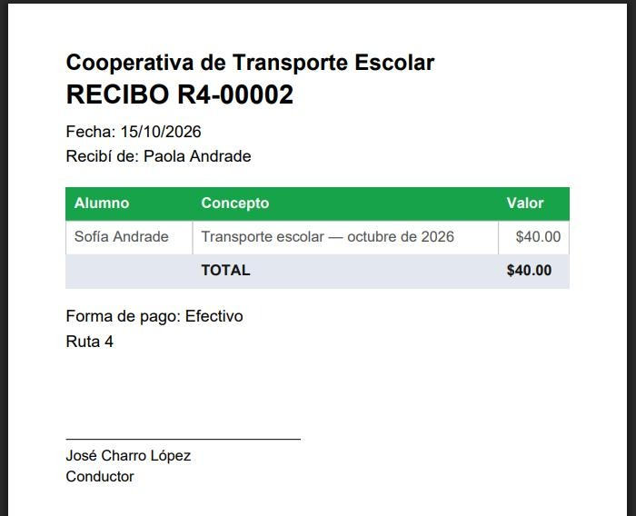 <b>Recibo en PDF</b>, listo para enviar por WhatsApp.</td>
  </tr>
</table>

### Informe diario en PDF

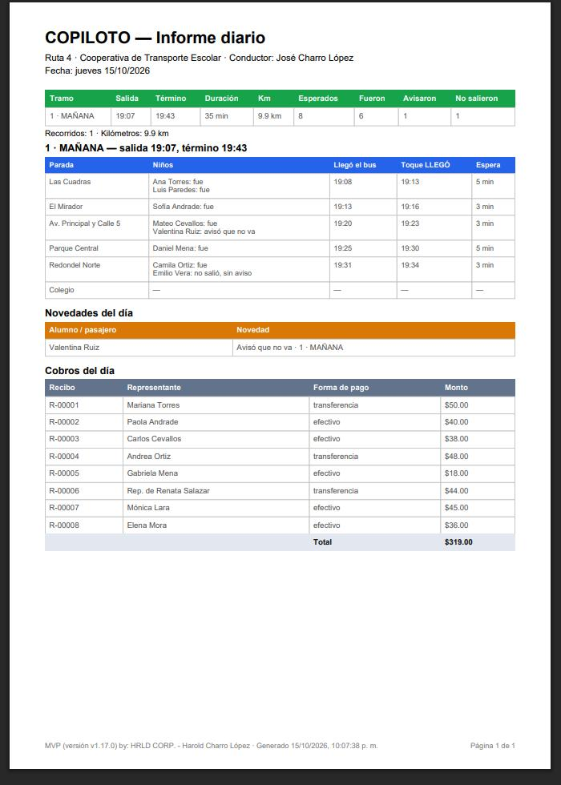

---

## Diseñado para la tercera edad

Los principios que guían cada pantalla:

1. **Un botón principal por pantalla.** Lo importante es lo más grande y lo más fácil de tocar.
2. **Nada es obligatorio al abrir.** Los formularios largos y los avisos van detrás de un botón; el inicio se ve siempre igual.
3. **Letra grande y ajustable**, con botones A− / A+ y buen contraste.
4. **Lenguaje de todos los días**, sin términos técnicos.
5. **Equivocarse no cuesta:** hay «solo ver», confirmaciones antes de lo importante y forma de deshacer.
6. **Voz primero:** lo que se muestra también se dice.
7. **Sigue funcionando sin señal:** guarda lo que pasa y lo envía cuando vuelve el internet.

---

## Por dentro, en lenguaje claro

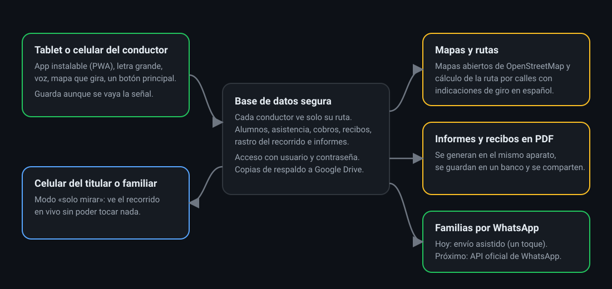

- **Aplicación web instalable (PWA):** se abre desde un enlace y se instala como cualquier aplicación, sin tienda de apps.
- **Base de datos con acceso por conductor:** cada conductor ve **únicamente su ruta**; el acceso es con usuario y contraseña.
- **Mapas abiertos** y **cálculo de ruta por calles** con indicaciones en español.
- **Informes y recibos en PDF**, generados en el propio aparato.
- **Mensajería por WhatsApp:** hoy, envío asistido; el objetivo es el envío automático con la API oficial de WhatsApp Business.

---

## Privacidad y menores

El sistema trata datos de niños y de sus familias, por eso se limita a lo imprescindible para el transporte (nombre, parada, contacto y asistencia). No se vende ni se usa para publicidad; las familias deciden si reciben avisos y pueden pedir que se eliminen sus datos. Más detalle en la [política de privacidad](https://copiloto-transporte-escolar.vercel.app/privacidad.html).

---

## Estado y camino

**Hecho y en uso real** desde octubre de 2026 con un primer conductor beta en Quito, **José Charro**:
recorridos con navegación y voz · pase de lista y novedades · cobros, recibos e informes en PDF · seguimiento en vivo · memoria del recorrido · envío asistido por WhatsApp · copias de respaldo.

**En camino:**
- Envío **automático** de avisos a las familias con la API oficial de WhatsApp Business.
- Panel con gráficos de la **vida del recorrido** (kilómetros, esperas, asistencia por día).
- Mapas sin conexión y servicio de rutas propio para escalar a más conductores y cooperativas.

---

## Propiedad intelectual y contacto

© 2026 **HRLD CORP CODE · Harold Charro López**. **Todos los derechos reservados.** El nombre, el diseño, los textos, las imágenes y el código de COPILOTO son propiedad intelectual privada. Este repositorio es solo de **presentación**: no autoriza copiar, modificar ni redistribuir el proyecto. Ver [LICENSE](LICENSE).

¿Quiere una demostración, usarlo en su ruta o hablar de una alianza?
- Correo: [hrldcorp93@gmail.com](mailto:hrldcorp93@gmail.com)
- GitHub: [@9hrld3](https://github.com/9hrld3)

---

## English summary

**COPILOTO is a driver-assistance app for school-transport drivers in Ecuador who work alone.** It is *not* a conventional route-tracking app for parents: the customer is the **driver**. While driving, the driver cannot read or type, so COPILOTO talks (turn-by-turn voice guidance, spoken stop announcements, a big clock with the target arrival time), keeps one large main button on screen, and handles the paperwork: attendance lists, absence notices (skipped stops), per-student fees with partial payments, PDF receipts, daily PDF reports, live follow-along for a second person, and assisted WhatsApp messaging to families. It is designed for an older user: large type, nothing mandatory on the home screen, clear language, undo-friendly flows. It works offline-first (it stores events and syncs later), each driver sees only their own data, and it runs as an installable web app (PWA) on phones and tablets.

**Status:** MVP in real daily use with a first beta driver in Quito since October 2026. **Source code is private**; this repository is a showcase only. © 2026 HRLD CORP CODE · Harold Charro López. All rights reserved. Contact: hrldcorp93@gmail.com.
